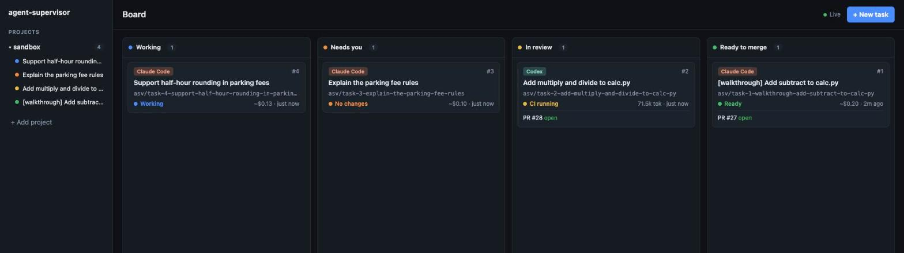

# agent-supervisor

[](https://github.com/ppoozine/agent-supervisor/actions/workflows/ci.yml)

Run several AI coding agents in parallel on your own machine, each in its own git worktree, and
let them fix their own failing CI and review comments, with hard limits on how many times they
retry and how much they spend. You only step in when a card lands in **Needs you**.



How it works, in one task's life:

1. You open a task on the board: a repo, an agent (Claude Code or Codex), and what to do.
2. The supervisor creates a worktree and a branch for it and runs the agent there.
3. When the agent finishes, the supervisor commits what is left, pushes, and opens a pull request.
   The agent never pushes.
4. It polls GitHub. If CI fails, it fetches the failing log and sends it back to the **same agent
   session**; it does the same for new PR comments and for merge conflicts.
5. When CI passes (and a review approves, if you ask for one), the card moves to **Ready to merge**.
   You merge on GitHub.

Every step is written to an append-only event log you can read on the task's page.

> **Only use it on repos you trust.** The agents run unattended with your credentials, and the
> permission policy is not a security boundary. Read the [trust model](docs/guide/trust-model.md)
> before you point it at anything important.

## Requirements

- macOS or Linux. Windows is not supported; use WSL.
- [uv](https://docs.astral.sh/uv/getting-started/installation/). It fetches Python 3.13 if you
  don't have it. Node.js is not needed unless you work on the board itself.
- `git`, and the [GitHub CLI](https://cli.github.com/) `gh`, logged in (`gh auth login`).
- `pgrep` and `ps`. On Linux they come from `procps`, which minimal images may lack.
- At least one agent:
  - **Claude Code**: nothing to install (the Python SDK bundles the CLI). Set `ANTHROPIC_API_KEY`
    in the shell you start the daemon from, or sign in with `claude auth login`.
  - **Codex**: install the [Codex CLI](https://github.com/openai/codex) and run `codex login`, or
    set `CODEX_API_KEY`.
- A GitHub repo cloned on your machine. Using it with a repo that has CI (for example GitHub
  Actions) is the point: without checks there is nothing to fix.
- Optional: `notify-send` on Linux for desktop notifications. macOS uses the built-in `osascript`.

## Install

Install the package from the [latest release](https://github.com/ppoozine/agent-supervisor/releases)
(it includes the board):

```sh
uv tool install https://github.com/ppoozine/agent-supervisor/releases/download/v0.3.0/agent_supervisor-0.3.0-py3-none-any.whl
agsv --help
```

To upgrade, run the same command with the newer file and `--force`.

`uv tool` gives the tool its own environment. That matters: an unrelated PyPI package called
`agent-supervisor` uses the same import name, `agent_supervisor`, and the two would overwrite each
other in a shared environment. This project is not on PyPI.

Other ways to install

- **From git**, following `main`. This gives the command line and the API but **no board**: the
  board is built at release time and git does not carry it.

  ```sh
  uv tool install git+https://github.com/ppoozine/agent-supervisor
  ```

- **From a clone**, to work on it. See [CONTRIBUTING.md](CONTRIBUTING.md).

## Your first task

1. Start the daemon. No config file is needed; data goes to `~/.agent-supervisor`.

   ```sh
   agsv serve
   ```

2. Open <http://127.0.0.1:8765>, then **Settings** in the sidebar. It lists which agents you can
   use, whether `gh` is ready, and the exact command to fix anything that is missing. After fixing
   something, press **Check again**. If you changed an environment variable, restart `agsv serve`
   from that shell instead.
3. **Add project** in the sidebar: give the path of your local clone. The GitHub repo and the
   default branch are read from `origin`. Leave "Require an approving review" off for now.
4. **New task**: pick the project and an agent, and describe a small change, for example
   "Add a `--version` flag to the CLI and a test for it".
5. Watch the card. It sits in **Working** while the agent runs; the task's page shows the agent's
   messages and tool calls as they happen. When the run ends the supervisor pushes and opens a pull
   request, and the card moves to **In review** while CI runs.
6. When CI passes the card moves to **Ready to merge**. Review the diff on the task's **Diff** tab or
   on GitHub, and merge on GitHub. The card then leaves the board for **Archive**.

If CI fails, the card goes back to **Working** with the label **Fixing CI**: the agent gets the
failing log. It tries at most three times; after that, or when something else goes wrong, the card
lands in **Needs you** with a label saying why. Send the agent a message from the task's page to
continue, or **Stop** or **Archive** the task. [Using agent-supervisor](docs/guide/usage.md)
explains every column, label, setting, and limit.

Stop the daemon with Ctrl-C. Runs that were active are stopped and marked **Interrupted**; send a
message to continue them after the next `agsv serve`.

## How it differs from similar tools

Agent Orchestrator, Conductor, Vibe Kanban, Claude Squad and others also run coding agents in
parallel worktrees, and several of them feed CI failures and review comments back to the agent.
Many have far more features than this project: a desktop app, an embedded terminal and chat,
merging from the app, a lead agent that splits work. If you want the most features, look at them
first.

What this project focuses on instead:

- **Hard limits on the feedback loop.** Every automatic retry is bounded: at most 3 CI fixes or
  conflict resolutions, 5 rounds of review comments, a cost and a token budget per task, a turn and
  a time limit per run. When a limit is hit, the task stops and waits for you; it never retries
  forever.
- **An audit trail.** Every run, tool call, permission denial, push, and PR comment is an event in
  an append-only table.
- **Made to be read and changed.** A local daemon with an [HTTP API](docs/guide/http-api.md) and a
  CLI, agents as [plug-in packages](docs/guide/adapters.md), and every design decision written down
  with the alternatives that were rejected ([`docs/`](docs/README.md), in Chinese).

## Status

agent-supervisor is at 0.x and maintained by one person. It is used daily by its author on macOS;
Linux is covered by CI. Known gaps that matter:

- No real isolation: agents run as you, on your machine. See the
  [trust model](docs/guide/trust-model.md) for what is and is not enforced.
- No login on the API; it only accepts requests from the local machine and the board.
- No merge button, no limit on how many runs go at once, no queue.
- Two agents built in: Claude Code and Codex. Others can be added as
  [adapters](docs/guide/adapters.md).

Until 1.0, the adapter interface, the HTTP API, the config file, and the database schema may change
in any minor release (0.3 to 0.4, and so on); the release notes list what changed. Pin the version
you build on.

## Documentation

- [Using agent-supervisor](docs/guide/usage.md): the board, the config file, the limits.
- [Trust model and known limitations](docs/guide/trust-model.md)
- [Writing an adapter](docs/guide/adapters.md): connect another coding agent.
  [`examples/example-adapter`](examples/example-adapter/) is a complete one that needs no account.
- [HTTP API](docs/guide/http-api.md): everything the board does, scripts can do too.
- [Design documents](docs/README.md) (in Chinese): the spec, the decision log, research notes.
- [Contributing](CONTRIBUTING.md) and [reporting a security issue](SECURITY.md)

## License

[Apache-2.0](LICENSE)
