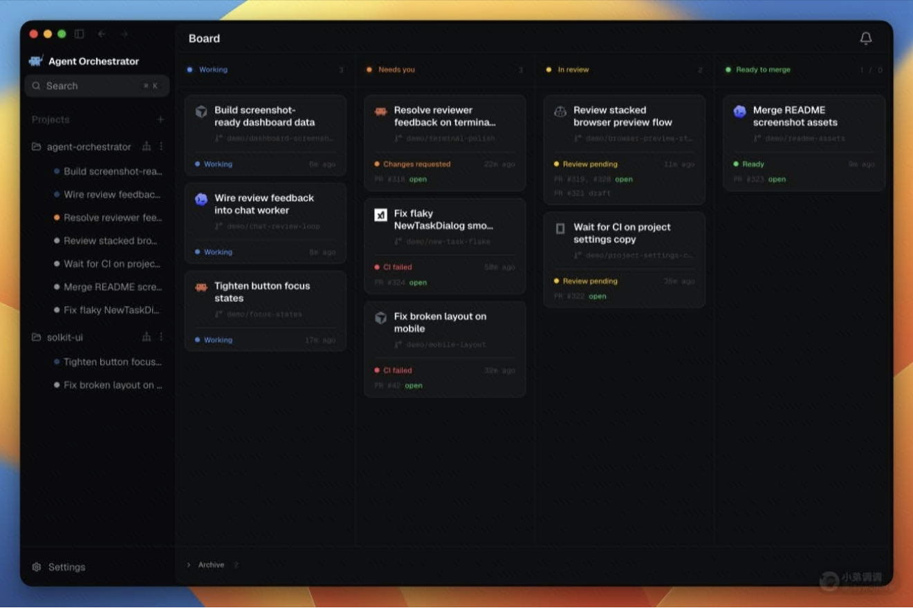

# 05 · 介面參考

最後更新：2026-11-15

階段 2 才會開始做介面。這份文件記錄我當初看到、想做成的樣子，以及 MVP 介面要有哪些東西。

## 參考畫面



這是開源專案 Agent Orchestrator 的看板截圖，是這個專案的起點。**只當作版面與資訊配置的參考**：我們自己實作，不複製它的程式碼、圖示與視覺設計。

## 從截圖讀到的版面

整個畫面是深色主題，分成左側欄與右側看板兩塊。

**左側欄**
- 最上方是產品名稱，下面一個搜尋框
- 「Projects」區塊：每個專案可展開，底下列出該專案的所有任務
- 每個任務前面有一個小圓點，顏色對應它目前的狀態
- 最下方是 Settings

**右側看板**
- 標題列寫「Board」，右上角有通知鈴鐺
- 四個欄位由左到右：**Working**、**Needs you**、**In review**、**Ready to merge**
- 每個欄位標題前有一個顏色圓點，右邊是該欄的卡片數量
- 最下方有一列可展開的「Archive」

**一張卡片上有什麼**

| 位置 | 內容 | 例子 |
| --- | --- | --- |
| 左上 | Agent 的圖示（看得出是哪一種 agent） | – |
| 第一行 | 任務標題，最多兩行 | Fix flaky NewTaskDialog smo… |
| 第二行 | Branch 名稱，小字、等寬字體 | demo/new-task-flake |
| 左下 | 狀態標籤，帶顏色圓點 | Working / Changes requested / CI failed / Review pending / Ready |
| 右下 | 多久以前更新 | 22m ago |
| 最底 | PR 編號與狀態（有開 PR 才顯示） | PR #324 open |

**顏色的用法**

| 顏色 | 意思 |
| --- | --- |
| 藍 | 進行中（Working） |
| 橘 | 需要人處理（Changes requested） |
| 紅 | 失敗（CI failed） |
| 黃 | 等待中（Review pending） |
| 綠 | 可合併（Ready）、PR open |

## 欄位與狀態標籤的對應

欄位是大分類，卡片上的狀態標籤是更細的原因。兩者都由 `status.py` 推導，不存資料庫。

| 欄位 | 卡片上可能出現的狀態標籤 |
| --- | --- |
| Working | Working、Fixing CI（CI 失敗，等待或正在自動修復）、Addressing review（PR 上有新留言，等待或正在處理）、Resolving conflict（PR 有衝突，等待或正在解） |
| Needs you | CI failed（不再自動修復）、Changes requested（有 review 意見但不能自動處理）、Merge conflict（有衝突但不能自動解）、Agent error、Over budget、Limit reached、Stopped、Interrupted、No changes |
| In review | Review pending、CI running、Checking mergeability（CI 通過，還不知道有沒有衝突） |
| Ready to merge | Ready |
| （Archive 區） | Archived、Merged、Closed |

`Over budget`、`Limit reached`、`Interrupted`、`No changes` 是我們自己加的，對應規格裡的花費上限、單一 run 上限、daemon 重啟復原、run 收尾規則。完整的推導條件見 `02-mvp-spec.md`。

## MVP 介面範圍

**要做**

- 左側欄：專案列表，展開看任務
- 四欄看板，卡片內容如上表
- 卡片右下角多顯示這個任務目前的花費，標示為估算值（例如 `~$0.42`）；agent 無法回報花費時改顯示 token 數
- 「New task」按鈕與表單：選專案、選 agent、輸入標題與任務描述
- 看板下方可展開的 Archive 區：已封存、PR 已合併或已關閉的任務
- 點卡片開啟任務詳情頁
- 透過 SSE 即時更新，不用重新整理

**任務詳情頁**

- 上方：標題、branch、PR 連結、目前狀態、累計 token 與花費
- 分頁一「Log」：agent 的即時輸出
- 分頁二「Events」：稽核紀錄，依時間排列，可依類型篩選
- 分頁三「Runs」：每一次 run 的觸發原因、時間、花費
- 分頁四「Diff」（階段 3 加入，畫面上排在 Log 之後）：branch 相對於基底分支的變更，依檔案分段
- 下方輸入框：對同一個 session 追加指令
- 按鈕：Stop、Archive。沒有 run 在執行時 Stop 不可按

**不做（階段 3 之後）**

- 搜尋、通知鈴鐺、Settings 頁
- 內嵌 terminal；diff 的並排檢視、語法上色、逐行留言
- 淺色主題

**永遠不做**

- 卡片拖曳（欄位是推導出來的，本來就不該手動拖）

## 版面草圖

```
┌──────────────┬───────────────────────────────────────────────────────┐
│ agent-       │ Board                                    [+ New task] │
│ supervisor   ├─────────────┬─────────────┬────────────┬──────────────┤
│              │ ● Working 3 │ ● Needs you │ ● In review│ ● Ready to   │
│ Projects     │             │      3      │      2     │   merge  1   │
│ ▾ project-a  │ ┌─────────┐ │ ┌─────────┐ │ ┌────────┐ │ ┌──────────┐ │
│   ● task 1   │ │ 標題    │ │ │ 標題    │ │ │ 標題   │ │ │ 標題     │ │
│   ● task 2   │ │ branch  │ │ │ branch  │ │ │ branch │ │ │ branch   │ │
│   ● task 3   │ │ ●Working│ │ │ ●CI     │ │ │ ●Review│ │ │ ●Ready   │ │
│ ▸ project-b  │ │~$0.42 8m│ │ │  failed │ │ │ pending│ │ │~$1.10 9m │ │
│              │ └─────────┘ │ │ PR #324 │ │ │ PR #322│ │ │ PR #323  │ │
│              │             │ └─────────┘ │ └────────┘ │ └──────────┘ │
│              ├─────────────┴─────────────┴────────────┴──────────────┤
│              │ ▸ Archive  2                                          │
└──────────────┴───────────────────────────────────────────────────────┘
```
