# 06 · 架構圖與流程圖

最後更新：2026-11-15

這份文件把 `02-mvp-spec.md` 的內容畫成圖，方便一眼看懂。**圖與規格不一致時以規格為準**，並回頭修正這裡的圖。

圖用 Mermaid 寫成，GitHub 上可以直接顯示；在編輯器裡看需要支援 Mermaid 的預覽功能。

| # | 圖 | 回答的問題 |
| --- | --- | --- |
| 1 | 系統架構 | 有哪些元件，誰和誰溝通 |
| 2 | 模組與外部指令 | 哪個模組可以呼叫哪個外部工具 |
| 3 | Adapter 架構 | 怎麼接上不同的 agent |
| 4 | 資料表關係 | 資料怎麼存 |
| 5 | 一張卡片的生命週期 | 卡片怎麼在欄位間移動 |
| 6 | 看板欄位怎麼推導 | 一個任務該放在哪一欄 |
| 7 | 自動修復條件 | 什麼時候會自動修 CI |
| 8 | 開任務到開 PR | 從送出任務到 PR 出現的過程 |
| 9 | CI 自動修復迴圈 | CI 失敗後發生什麼事 |
| 10 | Run 的生命週期 | 一次執行會怎麼結束 |
| 11 | Run 結束後的收尾 | commit、push、開 PR 的判斷 |
| 12 | 中止與封存 | 按 Stop 與 Archive 會發生什麼 |
| 13 | Daemon 啟動與復原 | 當機重啟後怎麼處理 |
| 14 | 路線圖 | 各階段的先後 |

---

## 1. 系統架構

一個 Python daemon 跑在本機，裡面有 API 與三個背景工作，全部共用一個 SQLite。

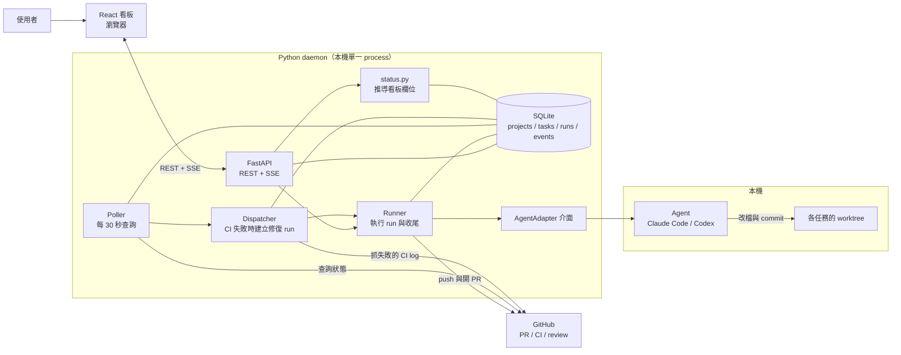

重點：

- Agent 只在 worktree 內改檔與 commit。**push 與開 PR 是 supervisor 做的**，不是 agent。
- 對 GitHub 一律用輪詢，不用 webhook。
- 看板欄位不存在資料庫裡，每次由 `status.py` 從資料算出來。

---

## 2. 模組與外部指令

對外部工具的呼叫集中在固定的模組，測試時可以整個換掉。

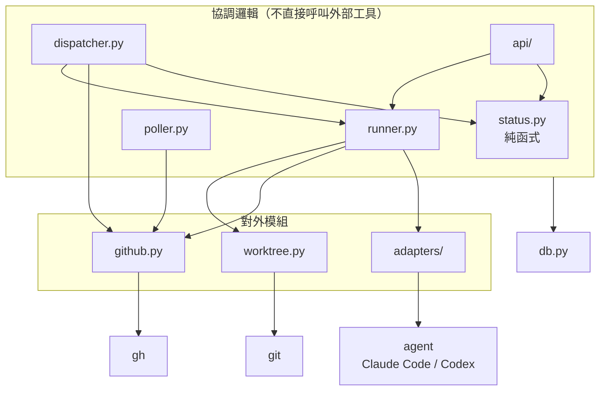

---

## 3. Adapter 架構

Runner 只認得 `AgentAdapter` 介面，不知道背後是哪一種 agent。每個 adapter 用 `capabilities` 說明自己做得到什麼。

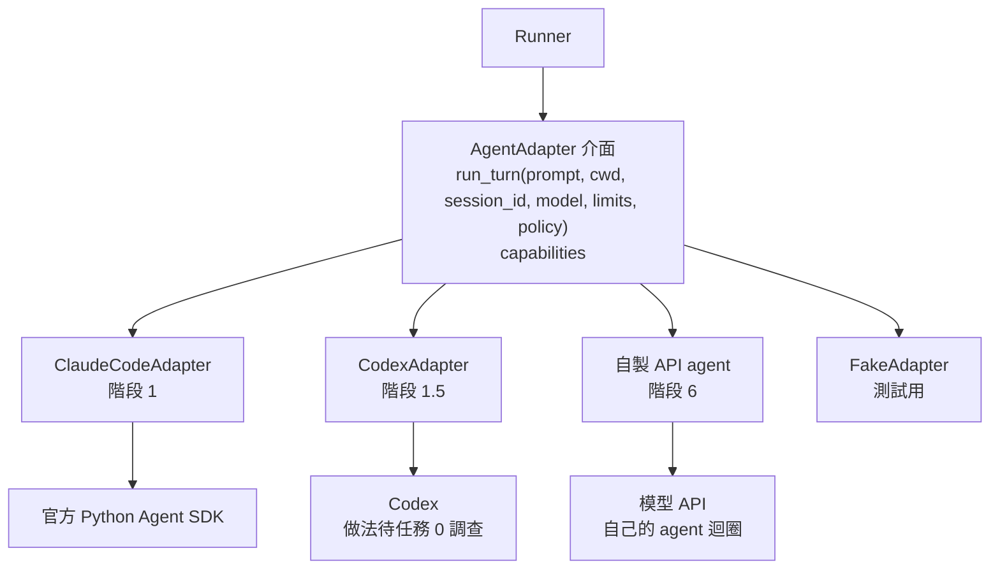

一輪對話的資料流：

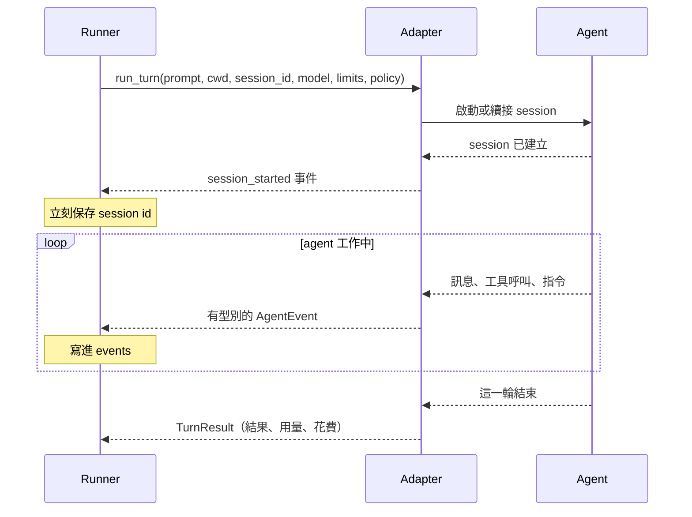

---

## 4. 資料表關係

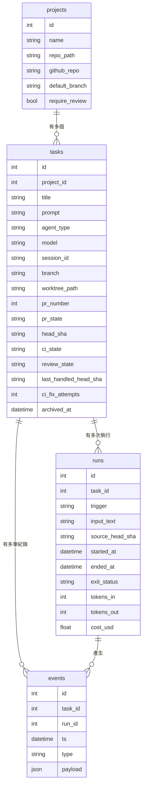

- `tasks` 上的 `pr_state`、`head_sha`、`ci_state`、`review_state` 是 Poller 對 GitHub 的快取。
- `events` 只新增，不修改、不刪除。`run_id` 可以是空的（例如 Poller 寫的事件）。
- 沒有「看板欄位」這個欄位。

---

## 5. 一張卡片的生命週期

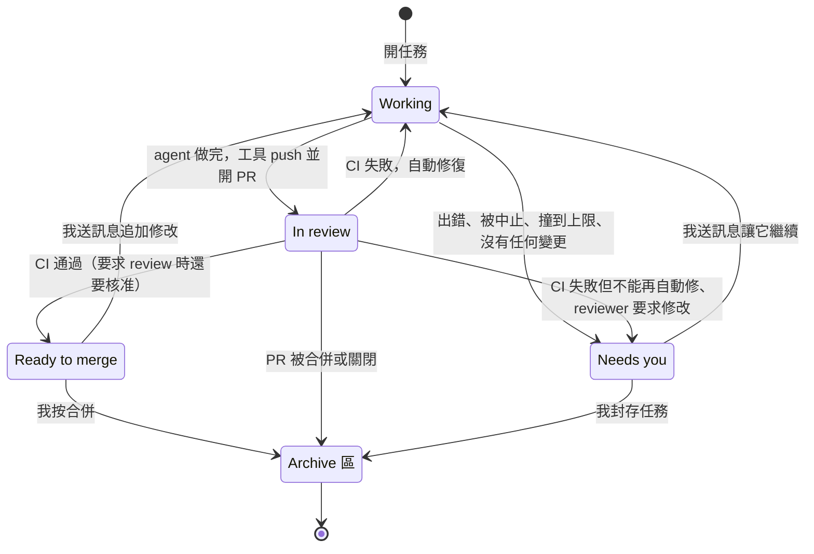

---

## 6. 看板欄位怎麼推導

由上往下判斷，先符合的優先。這張圖就是 `status.py` 要實作的邏輯。

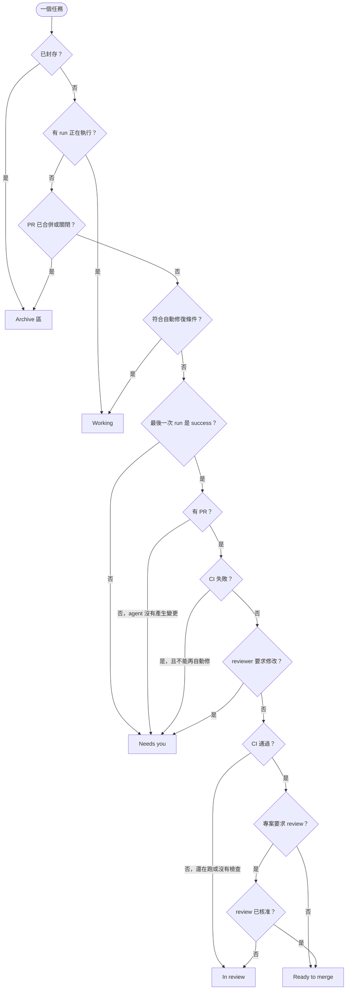

---

## 7. 自動修復條件

八項全部成立，Dispatcher 才會自動開一個修復的 run。`status.py` 與 Dispatcher 共用同一個函式。

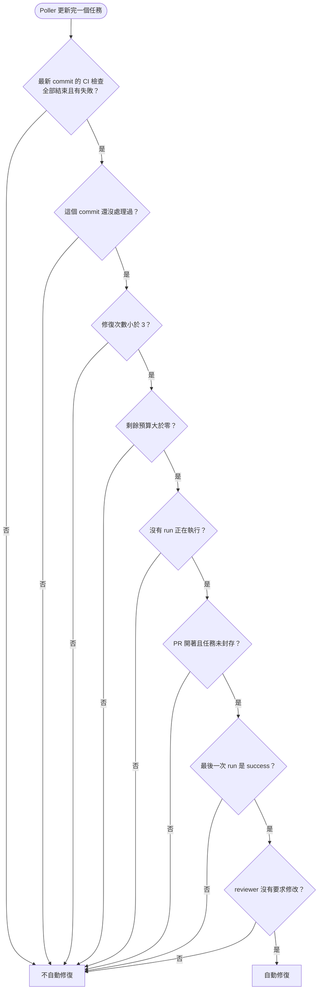

不自動修復不代表卡片一定進 Needs you：CI 沒失敗的任務本來就不需要修。CI 失敗卻不能自動修的任務才會進 Needs you。

---

## 8. 開任務到開 PR

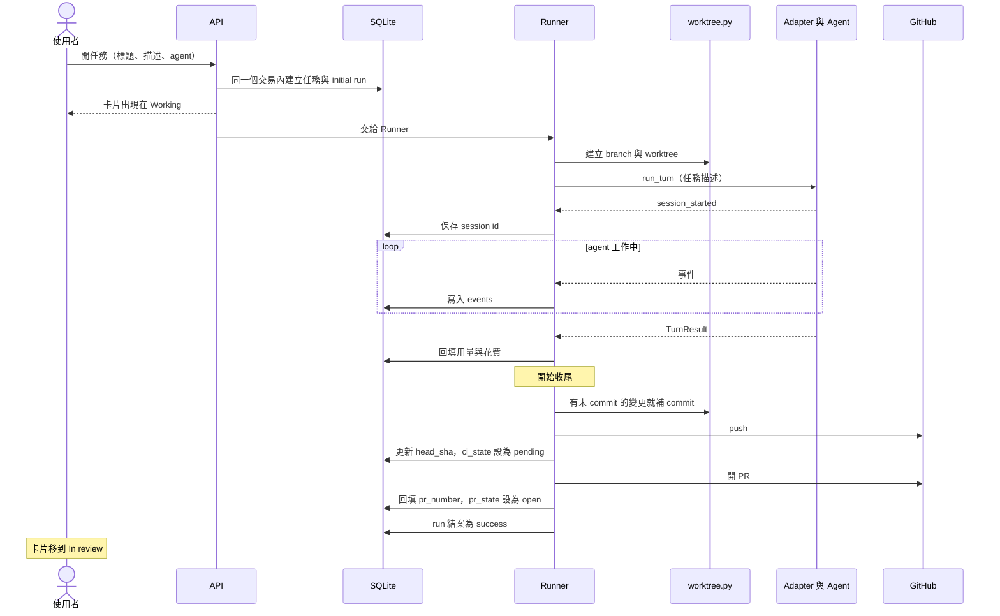

---

## 9. CI 自動修復迴圈

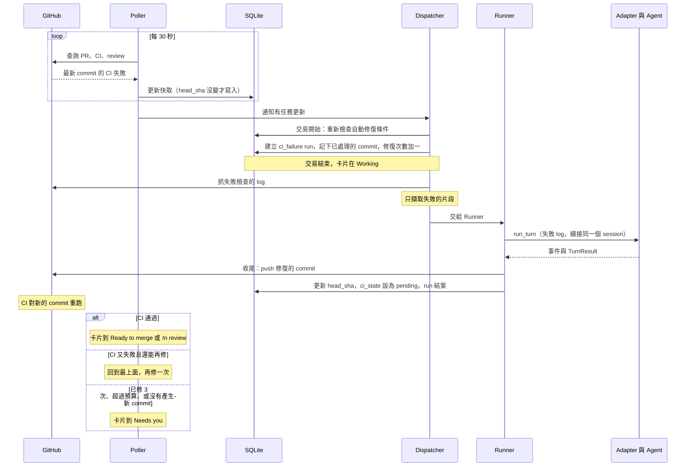

防止無限迴圈的五道防線：

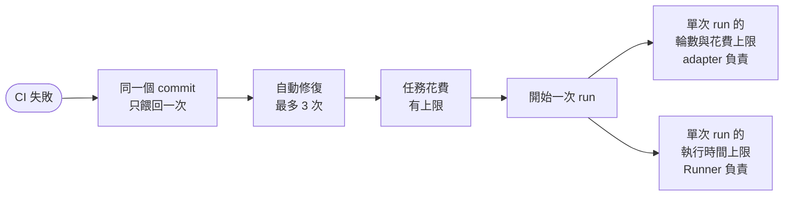

---

## 10. Run 的生命週期

一個 run 由同一個可取消的工作從頭負責到尾。四段都算「正在執行」，全部做完才結案。

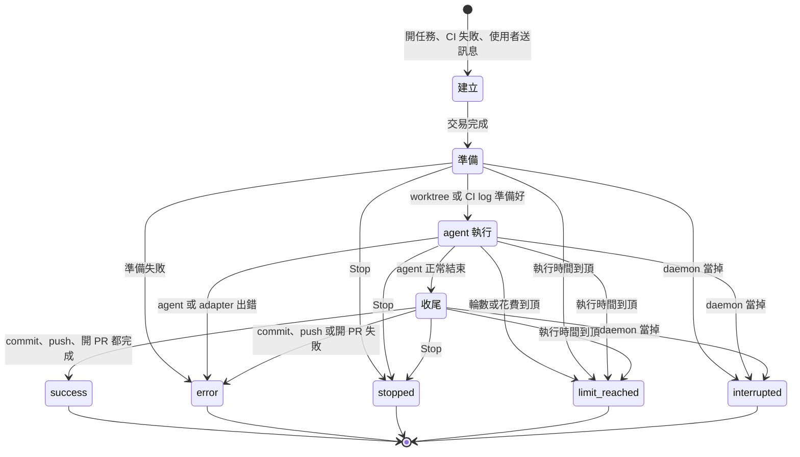

只有 `success` 會做完收尾並發布成果。其他四種結束方式都不自動發布，worktree 裡的變更原樣保留，卡片進 Needs you。

---

## 11. Run 結束後的收尾

每一步都先查現況再動手，所以重做一次不會重複 push 或重複開 PR。

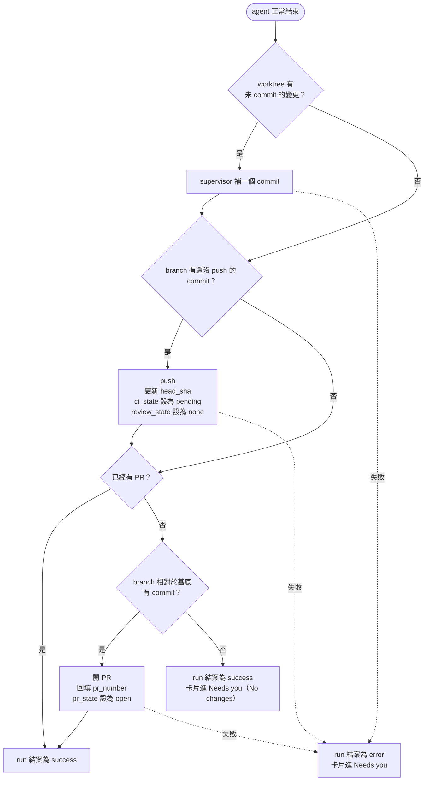

---

## 12. 中止與封存

建立 run、Stop、封存都要先拿到該任務的鎖，所以三者不會同時進行。

**按 Stop**

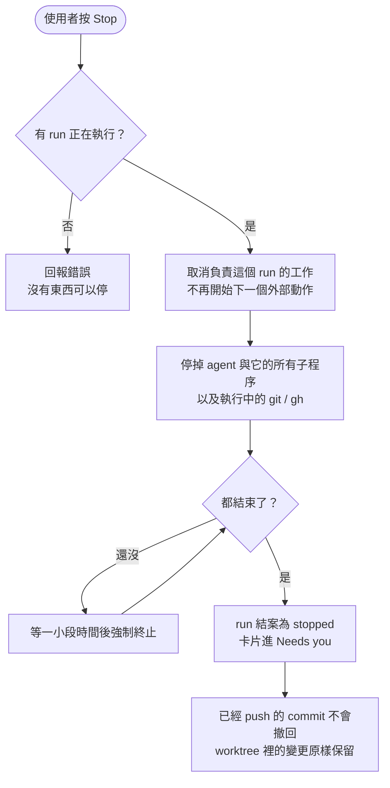

**按 Archive**

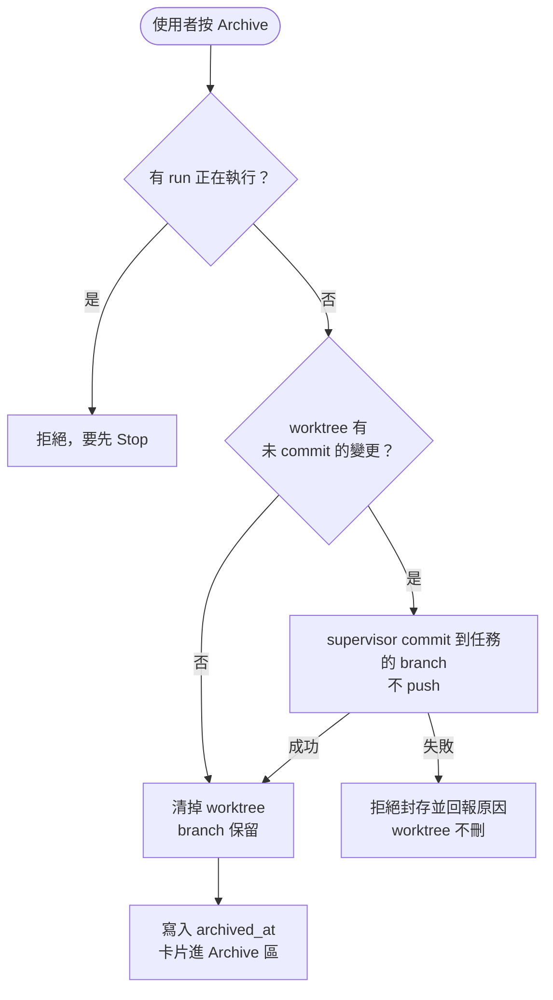

---

## 13. Daemon 啟動與復原

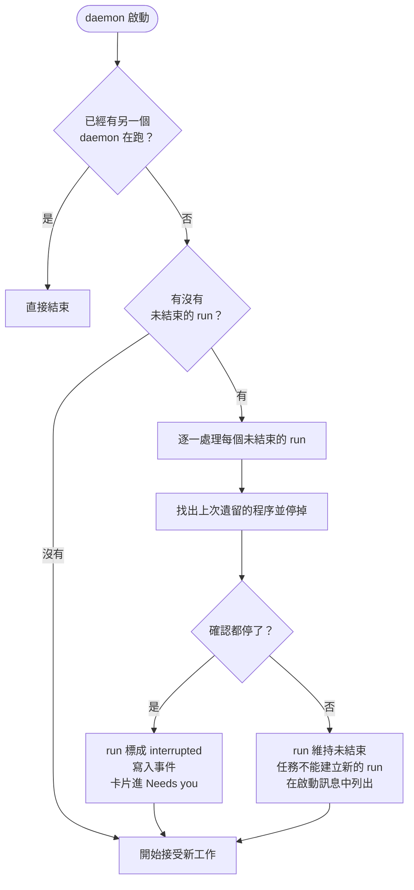

不自動重跑被中斷的 run，由我決定要不要送訊息讓它繼續。

---

## 14. 路線圖

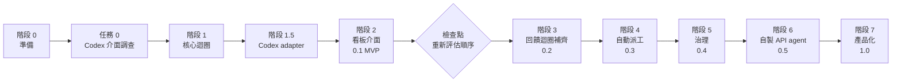

階段 1 內部的三步：

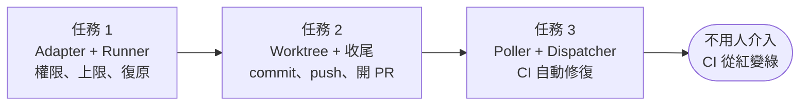
